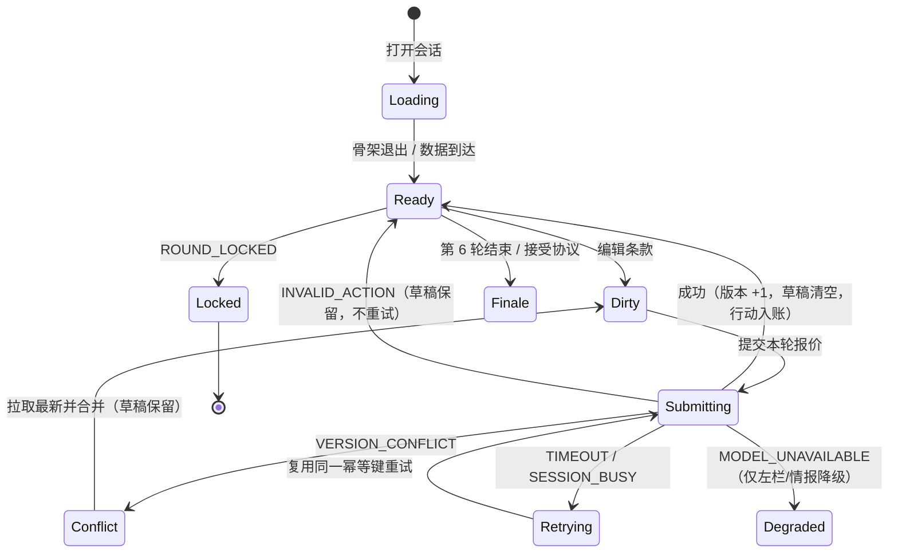

# Diplomat 界面信息架构设计（评审版）

> 交付物：IA 设计 + 旧版信息资产处置 + 验收自检
> 对应实现：`index.html`（单文件，无外部依赖）
> 状态：信息架构已定稿；旧版资产盘点**待旧版截图校准**（D 节）
> 团队角色：D = UI / 教练 Agent / Demo 统筹；A = 会话状态与错误码后端；B = 模型解说与情报；C = 议题检查与复盘数据

---

## 0. 结论先给

1. **主闭环**：报价板（默认视图）→ 矮版行动预演 → 提交/结束本轮 → 版本化协议抽屉 → 接受/拒绝 → 终局 → 基础复盘。
2. **布局**：左叙事 / 中执行 / 右评估，三段式；协议抽屉是跨视图全局覆盖层，不走路由，切视图不丢草稿。
3. **旧版不是自由聊天**（截图校准结果）：主交互是「谈判选项弹窗 + 确认/取消」，辅以「文本日志区」，不存在自由长文本输入。因此改造方向是：把一次性消费的选项列表，升级为可逐条编辑、可版本化的条款表；旧版文本日志降级为「对话」视图，仅作复盘素材，不承载条款产出。
4. **八个区域全部保留**，信息密度分级：中央 > 右栏 > 左栏 > 手牌 > 顶栏 > 议题条。左/右栏可折叠，主舞台不可折叠。
5. **取舍**：放弃「选项列表为主入口」，换可逐条编辑、可版本化的条款表；保留 `S/A/B/C/D` 五档评级（直接映射 `speaker_score` 的 90-100 / 70-89 / 50-69 / 30-49 / 0-29 区间，不另造评分规则）；放弃多边重构、观战模式、25 议题知识化、谈判树全树、突发模态弹窗、精致动画、真实国际事件预测。

---

## 1. 范围锁定（写死，不扩写）

| 类别 | 内容 |
|---|---|
| 必做 | 双人人机训练、双方 AI 自动推演、结构化报价、协议版本、终局、基础复盘、随机议题检查 |
| 不做 | 多边谈判重构、25 个议题全部知识化、复杂关系矩阵、精致动画、真实国际事件预测 |

任何在评审中提出的“要不要加多边视图 / 议题知识图谱 / 关系雷达”一律引用本节拒绝，不进入本轮排期。

---

## 2. 尺寸与可见性约束

`html, body { height:100%; overflow:hidden }`，页面级禁止横向滚动；仅各面板内部纵向滚动。

| 断点 | 左右栏（左/右） | 中央主舞台可用宽 | 主体高 | 视图区高 | 结论 |
|---|---|---|---|---|---|
| 1440×900 | 252 / 272（媒体查询 ≤1500px） | 872 px | 708 px | 526 px | 报价板（343px）+ 预演条（120px）+ 手牌（96px）同屏 |
| 1920×1080 | 280 / 300 | 1296 px | 888 px | 706 px | 同上，余量更大 |

固定高度：顶栏 56、议题条 40、手牌 96、视图 Tab 42、矮版预演 120、报价行 52×5。
**结论**：两档断点下，主报价板、行动预演、手牌、终局入口（顶栏）均在同一视口，不需要滚动即可看到。

---

## 3. 八区域拆解

| # | 区域 | 必含信息 | 控件 | 状态 | 为什么必须在这一层（不可下移的理由） |
|---|---|---|---|---|---|
| 1 | 顶栏 | 双方身份、模式、轮次 `R3/6`、**全局版本号**、连接态、终局入口 | 终局、DEMO、连接指示 | `connecting / live / busy / locked` | 版本号与轮次是**全局单例**。只存一份于此，报价板与抽屉只做只读渲染，从结构上消灭“三处版本不一致”。终局是跨视图出口，藏在任何 Tab 里都会降低可发现性 |
| 2 | 议题条 | 当前议题、序号 `03/06`、随机议题检查状态 | 切换议题、随机检查 | `pass / conflict / idle` | 议题是**作用域变量**：它同时决定条款集、事实依据、隐藏任务可见性。必须横跨三栏、位于主舞台之上，才能一处变更全域生效 |
| 3 | 左栏 · 战情解说 | 模型叙述段落 + “模型生成”标识 | 无（只读） | `loaded / degraded(空态)` | 长文本，放进主舞台会挤掉报价板。降级空态必须与内容区同位置，用户才能理解“这里本应有内容” |
| 4 | 左栏 · 局势摘要 | 3 条结构化要点 | 无 | 随状态刷新 | 散文不可被下游消费；要点化后才能绑定状态字段并进入复盘 |
| 5 | 左栏 · 事实依据 | 内容 + 来源 + 时间 + 可核验性 | 展开 | 静态 | 支撑“不编造”约束：每条结论都要能溯源。单方记录须标注，不得与可核验来源混排 |
| 6 | 左栏 · 会场纪要与事件 | 按轮次 `R1→R3` 的事件时间轴 | 翻页 | 静态 | 复盘以“事件”为索引，不依赖无限滚动；与对话视图分工明确：纪要是结论，对话是原文 |
| 7 | 中央主舞台 | 三视图（报价/对话/情报）、矮版行动预演 | Tab、条款下拉、提交、预演 | `loading / ready / dirty / submitting / error / conflict` | 全页**唯一写入口**，必须独占中央且不可折叠。矮版预演压缩到 120px 条带，避免为“看推演”而跳出主流程 |
| 8 | 右栏 · 我方态势 | 筹码、时间压力、已获让步、行动点 | 无 | 真实值 | 决策输入紧贴主舞台右缘，形成“看依据—做决策—查底牌”一次扫视 |
| 9 | 右栏 · 对方态势 | **全部标“估计值”+ 可信度百分比** | 无 | `estimated / unknown` | 硬性验收落点：对方信息必须是估计值。放在右栏可与“我方真实值”形成左右对照，视觉上不可能混淆 |
| 10 | 右栏 · 外交渠道 | 渠道名 + 可用/冷却 | 发起 | `ready / cooldown` | 是行动的前置条件，必须与手牌同屏可见，否则用户选卡后才发现渠道不可用 |
| 11 | 右栏 · 隐藏任务 | 任务文本 + 完成态 | 无 | `done / pending` | 教练 Agent 的评分依据，必须可见但不抢焦点 |
| 12 | 右栏 · BATNA | 我方替代方案；对方恒为“未知” | 无 | `known / unknown` | 对方 BATNA 无可靠线索时**必须显式显示“未知”**，不得填充估计值伪装成信息 |
| 13 | 协议抽屉 | 版本号、逐条条款、未决标记、接受/拒绝 | 接受、拒绝、合并 | `closed / open / has-pending / conflict` | 协议是**跨视图全局对象**，必须一键唤起。用覆盖层而非路由：切到情报视图再回来，草稿仍在 |
| 14 | 底部手牌 | 策略卡（成本）、行动点 `3/5`、结束本轮 | 选卡、结束本轮 | `available / exhausted / round-locked` | 回合资源与闸门。固定底部形成肌肉记忆；`ROUND_LOCKED` 的禁用反馈就在操作点旁 |
| 15 | 覆盖层 | 骨架屏、错误条、重试、终局覆盖 | 重试、丢弃草稿、返回 | `skeleton / error(code,detail) / retry` | 全局状态，不属于任何业务区。骨架只覆盖“正在取数”的区域，不做整页白屏 |

---

## 4. 主闭环与状态机



三条硬规则：
1. **失败不改变草稿**：任何错误分支都不得清空 `draft`。
2. **重试复用幂等键**：`TIMEOUT`、`SESSION_BUSY`、`VERSION_CONFLICT` 合并后重提，一律使用同一 `key`；已入账的 `key` 二次提交直接拦截并提示，不再记账。
3. **模型故障不阻塞报价**：`MODEL_UNAVAILABLE` 只让解说与情报降级为空态，报价板与预演照常工作，因为二者的数据来自会话状态而非模型。

---

## 5. 错误码 → UI 行为映射

后端错误格式已定，仅使用 `error` 与 `detail` 两个字段，不新增任何字段。

| 错误码 | 反馈位置 | 行为 | 是否重试 | 草稿 |
|---|---|---|---|---|
| `INVALID_ACTION` | 报价板顶部行内红条 | 行动不生效 | 否（需用户改） | 保留 |
| `SESSION_BUSY` | 顶栏连接灯 + 提交按钮 | 自动重试 1 次，转手动 | 是（同键） | 保留 |
| `MODEL_UNAVAILABLE` | 左栏解说 / 情报视图 | 降级空态 | 否 | 保留 |
| `ROUND_LOCKED` | 手牌 + 结束本轮 | 整条禁用 | 否 | 保留 |
| `VERSION_CONFLICT` | 报价板冲突条 | 拉取服务端版本，差异可见，需确认合并 | 合并后同键重提 | **保留并计数** |
| `TIMEOUT` | 触发控件旁 + 顶部 toast | 展示重试 | 是（同键） | 保留 |

错误展示统一附带原始 JSON（等宽字体），便于评审时核对字段未被自造：

```json
{"error":"TIMEOUT","detail":"上游未在时限内返回，草稿已保留。"}
```

---

## 6. 数据一致性约束

| 约束 | 落地方式 |
|---|---|
| 所有数字同源 | 单一状态对象，三栏与抽屉只做只读渲染，前端不二次计算金额/比例 |
| 版本号三处一致 | 顶栏 `#mVer`、报价板底部 `#bdVer`、协议抽屉 `#drVer` 全部由同一个 `S.version` 渲染，无独立副本 |
| 对方信息不可为真值 | 右栏对方态势整块加“估计值”横幅；每个数值带 `估计` 标签与可信度百分比；对方 BATNA 固定“未知” |
| 未决条款不可被签署 | 抽屉检测到 `status=pending` 时，接受按钮 `disabled`，并在按钮上方列出未决条款编号与原因 |
| 不编造收益 | 终局页仅呈现会话状态中的实际数值，模型生成内容在左栏单独标注“仅供参考” |

### 6.1 教练 Agent 评分契约（speaker_score）

评分口径直接采用《发言评分标准》，不新增维度、不改权重、不自行解释区间。

| 维度 | 字段名 | 权重 | 落点 |
|---|---|---|---|
| 立场清晰度 | `position_clarity` | 30% | 终局维度条 1 |
| 外交策略运用 | `diplomatic_tact` | 30% | 终局维度条 2 |
| 情绪控制力 | `emotional_control` | 20% | 终局维度条 3 |
| 实质内容质量 | `substance_quality` | 20% | 终局维度条 4 |

| 规则 | 约定 |
|---|---|
| 总分 | `立场×30% + 策略×30% + 情绪×20% + 内容×20%`，取整 |
| 评级映射 | 90-100 → `S`；70-89 → `A`；50-69 → `B`；30-49 → `C`；0-29 → `D` |
| feedback | 一句话 20-40 字，先亮点后问题，专业具体，不泛泛而谈 |
| 首轮特例 | 第 1 轮对方未发言时 `speaker_score` 必须为 `null`；UI 显示“首轮不计分”，不填 0、不生成替代分数 |
| 数据来源 | 四维分与总分均由服务端返回，前端只做展示与评级映射，不本地重算加权 |

**演示态说明**：原型内置 `total: 75` 与四维分，仅用于展示渲染路径；该数值为演示数据，不代表真实收益或真实测评结果。

---

## 7. 旧版信息资产处置（已按 10 张截图校准）

> 校准时间：2026-11-11。素材：`old-01` ~ `old-09` 共 10 张实景截图。
> 校准结论：**旧版不是口水文聊天**，而是「谈判选项弹窗 + 确认/取消 + 文本日志」。原假设中 3 条被推翻，见 7.1。

### 7.1 原假设纠错

| # | 原假设 | 截图事实 | 对设计的影响 |
|---|---|---|---|
| 1 | 旧版有自由长文本输入框 | 无。中央为“谈判选项”弹窗，底部“确认/取消”，提示“点击选项进行谈判” | “自由输入降级”作废。改造正确定性为：**一次性选项列表 → 可逐条编辑的条款表** |
| 2 | 旧版是双方消息气泡流 | 是线性“文本日志区”，无气泡结构 | 「对话」视图保留，但语义为“记录”，不作主入口 |
| 3 | 旧版有表情 / 头像动效 | 截图未见 | 该删除项作废，不再作为改造理由 |

### 7.2 逐屏处置

| # | 截图 | 旧版真实构成 | 处置 | 理由 |
|---|---|---|---|---|
| 1 | `old-01` 首页 | 三卡并列：双边谈判 / 多边谈判 / 观战模式 + 底部“学习模式” | 保留双边入口；删除多边与观战；学习模式由教练 Agent（隐藏任务）承接 | 范围不做多边重构；观战无人机训练价值；每多一个入口就多一条维护路径 |
| 2 | `old-02` 双边 1440 | 顶栏 `ROUND 06/15`；左“实时分析 + 事件日志”；中“谈判选项”弹窗 + 文本日志；底“确认/取消”+ 快捷键提示 | 顶栏改 `R3/6`；左栏拆四块；中央改报价板；底部改手牌 | 主闭环要求 |
| 3 | `old-02b` 双边 1920 | 同上宽屏版 | 作为 1920 断点基准 | 硬性验收需双档 |
| 4 | `old-03` 多边谈判 | `GLOBAL AI GOVERNANCE` 半球地图 + 多国阵营列表 | 整体删除 | 不做多边重构与真实国际事件预测 |
| 5 | `old-04` 观战视角 | 纯观战、无操作入口 | 删除 | 不属于双人人机训练 |
| 6 | `old-05` 复盘报告 | `S` 徽章 + `92/100` + 外交大师 + 能力评估 / 任务完成 / 综合得分三面板 | 保留 `S/A/B/C/D` 徽章与总分；三面板改为“四维评分 + 一句话 feedback + 三段结构复盘” | 五档区间已由《发言评分标准》定义，可直接映射，无需另造评分规则 |
| 7 | `old-06` 场景选择 | 起手式·多方对谈、事件列表、阵营网格 | 议题条 + 事实依据承接 | 场景切换保留，多方阵营清单删除 |
| 8 | `old-07` 教学页面 | 开局布局、AI 模型选择、进度条、开始游戏 | 不做独立页；模型可用性交由 `MODEL_UNAVAILABLE` 兜底 | 八区域已写死，额外页面不进本轮 |
| 9 | `old-08` 谈判树弹层 | 议题 / 分支树弹层 | 删除全树，只保留当前议题 5 条条款 | 不做 25 议题知识化 |
| 10 | `old-09` 突发事件 | `EVENT LOG` 模态弹窗“发现突发事件，现在开始应对吧” | 降级为左栏“会场纪要与事件”时间轴 + 议题条随机检查 | 模态遮挡主舞台；随机检查必须常驻可见 |

### 7.3 元素级处置

| 旧版元素 | 新版位置 | 处置 | 理由 |
|---|---|---|---|
| `ROUND 06/15` | 顶栏 | 改为 `R3/6` | 15 轮无法在 Demo 中闭环 |
| 行动点 `0/2` | 底部手牌 | 改为 `3/5` | 2 点上限导致每轮只做一件事，展示不出取舍 |
| 实时分析面板（含下拉框） | 左栏战情解说 + 右栏态势 | 拆分保留，去掉下拉框 | 双边场景分析对象固定，下拉是多一层操作 |
| 事件日志 | 左栏“会场纪要与事件” | 保留，改时间轴 | 按轮次索引更利于复盘 |
| 谈判选项弹窗 | 中央报价板 | 升级为主入口 | 选项一次性消费、无版本、无逐条沉淀 |
| 文本日志区 | 中央“对话”视图 | 保留，降级为次要视图 | 名称按用户写死的“报价 / 对话 / 情报”三视图，不改名 |
| 确认 / 取消 | 手牌 + “提交本轮报价” | 替换 | 单按钮承担不了行动点与回合边界 |
| 底部快捷键提示条 | — | 删除 | 鼠标为主，且需腾出 96px 给手牌 |
| 阵营 / 国家列表 | 右栏“外交渠道” | 部分承接（3 条渠道） | 双边只保留渠道，多国阵营属多边范围 |
| 半球地图 | — | 删除 | 超出范围 |
| 资源图标 | 右栏“我方态势” | 转为筹码 + 行动点 | 数值必须与得分同源 |
| 设置按钮 | 顶栏 | 保留为 `DEMO` + 终局入口 | 系统级操作归顶栏 |
| `S/A/B/C/D` 评级 | 终局 | 保留，映射 0-100 区间 | 旧版已有，且评分标准自带五档区间，无需另设规则 |
| 三统计面板 | 终局三卡 | 保留 | 基础复盘骨架可直接复用 |
| 衬线大标题 + 无衬线正文 | 全局 | 保留 | 旧版“情报感”的主要来源，比颜色更关键 |
| 金色 `#C5A059` / `#D4AF37` | 全局 | 收敛为 `#c9a227` | 旧版双金并存导致层级不清，统一为主金 + 暗金 |
| 突发事件模态弹窗 | 左栏时间轴 | 降级 | 遮挡主舞台 |
| 谈判树 | — | 删除 | 同上 |

**旧版对方信息的问题**：阵营列表带数值状态，但无任何“估计值 / 可信度”标注，视觉上等同真值。新版一律打 `估计` 标签 + 可信度百分比，对方 BATNA 固定“未知”——这是新旧差最大的合规点。

### 7.4 参数口径差异（须写入评审材料）

| 项 | 旧版 | 新版 | 为什么改 |
|---|---|---|---|
| 轮次 | `06/15` | `R3/6` | 训练单场 6 轮；15 轮走不到终局 |
| 行动点 | 上限 2，本轮 `0/2` | 上限 5，本轮 `3/5` | 5 点容纳“2 点策略卡 + 1 点渠道 + 2 点预留” |
| 主交互 | 选项列表 + 确认 | 条款表逐条编辑 + 提交 | 选项产不出协议版本 |

### 7.5 落地状态

| 产物 | 状态 |
|---|---|
| `index.html` | 无需改动。三视图命名、轮次 6、行动点 5 已按新口径实现 |
| `docs/demo-storyboard.md` | 无需改动。10 个镜头不涉及旧版对照 |
| `docs/ia-design.md` | 已按本节校准，第 0 节结论同步修正 |

---

## 8. 验收自检（逐条）

判定口径：
- **静态通过** = 代码结构已保证，静态检查脚本实测通过。
- **待实测** = 需要真实浏览器渲染确认，当前环境无浏览器自动化，不记为已通过。

| # | 验收条款 | 实现位置 | 静态结论 | 浏览器实测 |
|---|---|---|---|---|
| 1 | 1440×900 主报价板可见 | `#body` grid + 媒体查询 ≤1500px；报价板 343px / 视图区 526px | 结构性满足 | 待实测 |
| 2 | 1440×900 行动预演可见 | `#rehearsal` 固定 120px、非弹层 | 结构性满足 | 待实测 |
| 3 | 1440×900 手牌可见 | `#hand` 固定 96px | 结构性满足 | 待实测 |
| 4 | 1440×900 终局入口可见 | 顶栏 `#finaleBtn` 固定 56px 内 | 结构性满足 | 待实测 |
| 5 | 1920×1080 同上四项可见 | 左右栏 280/300，中央 1296px | 结构性满足 | 待实测 |
| 6 | 无横向滚动 | `html,body{overflow:hidden}` + 容器 `min-width:0` | **通过** | 待实测确认 |
| 7 | 数字来自同一服务端状态 | 单一 `S` 对象，只读渲染 | **通过** | — |
| 8 | 版本号三处一致 | `#mVer` / `#bdVer` / `#drVer` 同源 `S.version` | **通过** | 待实测目视 |
| 9 | 加载骨架 | `.skel` + 报价板骨架行 + 左栏骨架 | **通过** | 待实测 |
| 10 | 失败保留草稿 | 错误分支不清 `S.draft`；`#draftChip` 计数 | **通过** | 待实测 |
| 11 | 重试不产生两笔相同行动 | `S.submittedKeys[key]` 拦截 + `retryKey` 复用 | **通过** | 待实测 |
| 12 | 未决条款时接受按钮解释原因 | `renderDrawer()` 计算 `pendingIds`，禁用 + 文案 | **通过** | 待实测 |
| 13 | 不显示对方私有底牌 | 右栏无原始值字段；对方 BATNA = 未知 | **通过** | — |
| 14 | 对方信息标估计值与可信度 | `.est-tag` + `.est-banner` + 可信度条 | **通过** | 待实测 |
| 15 | 错误码不自造字段 | 仅 `error` / `detail`，6 码全覆盖 | **通过** | — |

**自检不合格项：无。** 未完成项仅为第 1–6、8–12、14 条的浏览器像素级实测，属于环境能力缺口，不是实现缺陷。

---

## 9. 已知边界

1. 前端为纯静态演示，提交结果由内置模拟器产生，**不代表真实后端行为**；接入真实接口时，幂等键需与服务端确认承载方式（请求体或请求头），本设计不擅自规定字段。
2. 旧版资产盘点已于 2026-11-11 按 10 张实景截图校准完毕，结论见第 7 节；原假设中 3 条被推翻（见 7.1），不再存在待校准项。
3. 1440 档依赖 `max-width:1500px` 媒体查询，若浏览器窗口小于 1440，会继续收窄，不在本轮验收范围。